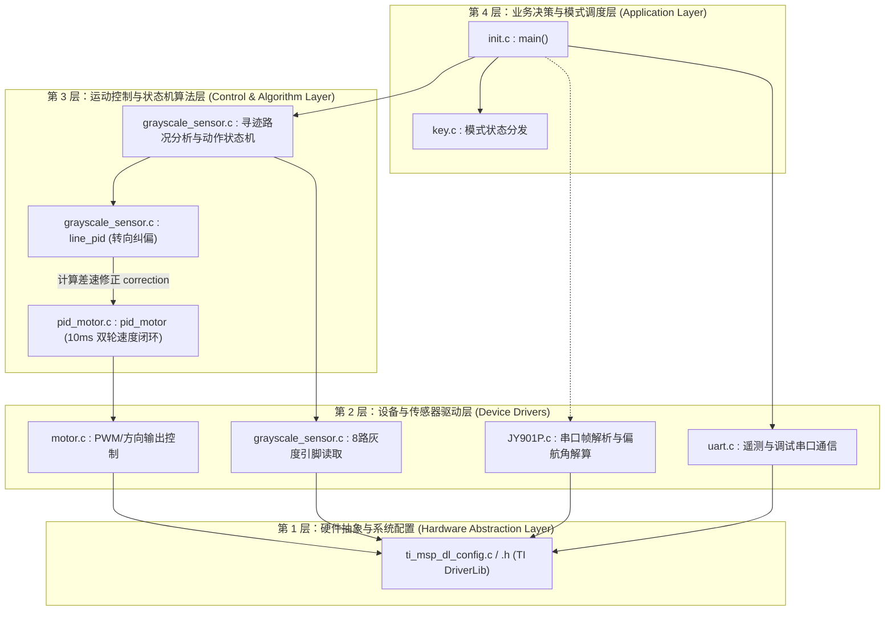

# 02 - 软件分层架构与系统调用流 (Software Architecture & Flow)

---

## 1. 软件四层体系结构 (Four-Layer Architecture)

本项目采用模块化嵌入式前后台分层架构，清晰划分各层职责与调用边界：

`hcsr04.c/.h` 保留在源码树中。当前 SysConfig 未配置超声波引脚和定时器，`hcsr04.c` 的测距实现被条件编译排除，因此不属于当前运行路径。

---

## 2. 核心运行机制与时间域划分

系统运行分为 **主循环 (后台任务)** 与 **中断服务程序 (前台任务)**：

### 2.1 前台高优先级任务 (中断域 Interrupt Domain)
- **GPIOA 双边沿中断 (`GROUP1_IRQHandler`)**：
  - 优先级：最高。
  - 任务：只要电机转动，编码器 A/B 相电平发生跳变即刻触发，通过状态跃迁查找表累加脉冲数。
- **10ms 定时器中断 (`pid_timer_INST_IRQHandler` on `TIMG0`)**：
  - 周期：严格 10ms。
  - 任务：禁止编码器中断进行快照读取，将 10ms 计数值与目标速度通过 PID 计算后，即刻输出新的左右轮 PWM 占空比。
- **5ms 定时器中断 (`key_timer_INST_IRQHandler` on `TIMG7`)**：
  - 周期：5 ms，每次调用 `key_tick1ms()`（保留原函数名）；消抖阈值为 6 次，按 30 ms 配置确认按下和松开。
  - 任务：按键消抖状态机更新并发布运行模式。
- **10ms 定时器中断 (`track_timer_INST_IRQHandler` on `TIMG8`)**：
  - 任务：按从左到右的 GRAY1～GRAY8 顺序读取 8 路灰度，计算线位置和路况；将归一化读数（黑线为 1）、`pattern` 和 `error` 作为同一次采样发布。

### 2.2 后台任务 (主循环轮询 Background Loop in `init.c`)
1. 上电先将左右轮目标置零；主循环读取 `key_getmode()`，模式变化时复位循迹状态并立即将目标置零；
2. `gray_sample()` 收到新采样后调用 `trackcontroll()`；按键 1 执行 `track_run_normal()`，根据灰度偏差纠偏，并在右分岔确认后进入直行锁定；按键 4 回到待机且目标为零；
3. 每次处理灰度样本后调用 `motor_rlencoder_cnts(&sample, current_mode)`，打印从左到右的 8 路灰度读数、识别出的 `pattern` 名称、当前运行状态名称、消抖后识别出的按键模式（`key=key1_putong` 等）和左右电机 PID 下发的 PWM 值，最多约每 10 ms 一次。串口发送位于主循环，发送等待已设置上限。若主循环处理不及，单槽样本会被下一次采样覆盖。

### 2.3 烧录与调试工具

- `scripts/probe.ps1 -Action Flash` 使用 `openocd/xds110-mspm0g3507.cfg`，通过 XDS110 写入 `build/init.out`，完成校验后复位。
- 默认的 `-Action Check` 检查 XDS110；`-Action CheckWireless` 可检查无线 DAP，`-Action CheckXds110` 为兼容写法。
- VS Code 的 `XDS110 attach (no flash)` 配置使用 `request: attach`，只连接并暂停当前固件，不运行构建任务，也不下载固件；`build/init.out` 必须与芯片上的固件版本一致。
- `XDS110 build, flash and debug` 配置使用 `request: launch`，先运行构建任务，再烧录 `build/init.out` 并进入调试。两个配置都不额外设置 `main` 临时断点，以免占用有限的硬件断点资源。
