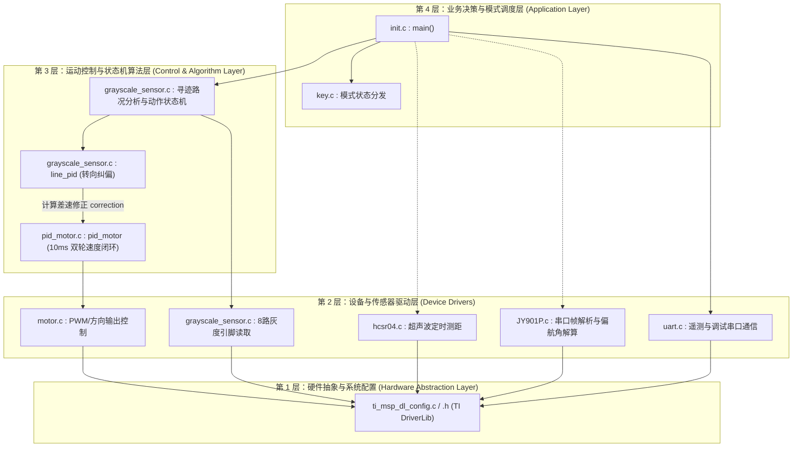

# 02 - 软件分层架构与系统调用流 (Software Architecture & Flow)

---

## 1. 软件四层体系结构 (Four-Layer Architecture)

本项目采用模块化嵌入式前后台分层架构，清晰划分各层职责与调用边界：

---

## 2. 核心运行机制与时间域划分

系统运行分为 **主循环 (后台任务)** 与 **中断服务程序 (前台任务)**：

### 2.1 前台高优先级任务 (中断域 Interrupt Domain)
- **GPIOA 双边沿中断 (`GROUP1_IRQHandler`)**：
  - 优先级：最高。
  - 任务：只要电机转动，编码器 A/B 相电平发生跳变即刻触发，通过状态跃迁查找表累加脉冲数。
- **10ms 定时器中断 (`pid_timer_INST_IRQHandler` on `TIMG0`)**：
  - 周期：严格 10ms。
  - 任务：禁止编码器中断进行快照读取，将 10ms 计数值与目标速度通过 PID 计算后，即刻输出新的左右轮 PWM 占空比。
- **1ms 定时器中断 (`key_timer_INST_IRQHandler` on `TIMG7`)**：
  - 周期：1ms（内部累加 10 次进入 10ms 消抖逻辑）。
  - 任务：按键消抖状态机更新。
- **100ms 超声波定时器中断 (`hcsr04_timer_INST_IRQHandler` on `TIMG6`)**：
  - 周期：100ms。
  - 任务：拉高 TRIG 引脚 10μs 发送测距声波。

### 2.2 后台任务 (主循环轮询 Background Loop in `init.c`)
1. 模式检测：扫描或获取当前按键选定的 `current_mode`；
2. 状态机清零：若检测到模式切换，调用 `condition_rst()` 复位寻迹状态机；
3. 执行具体模式任务（普通循迹、特殊赛道、摆动寻迹）；
4. 遥测回传：调用 `motor_encoder_condition()` 通过 UART0 输出电机速度与 PID 调试波形数据；
5. 适度延时 10ms 释放 CPU。
