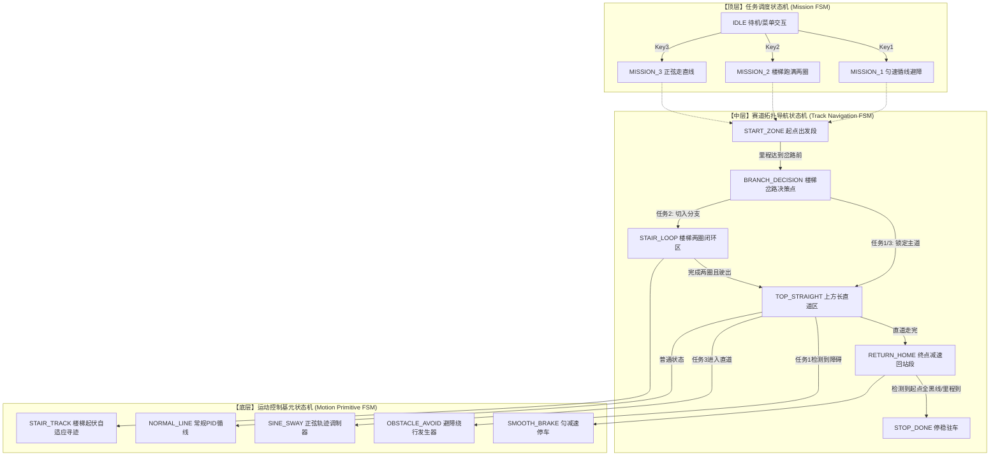
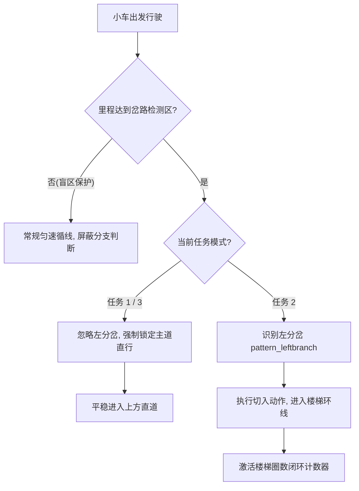
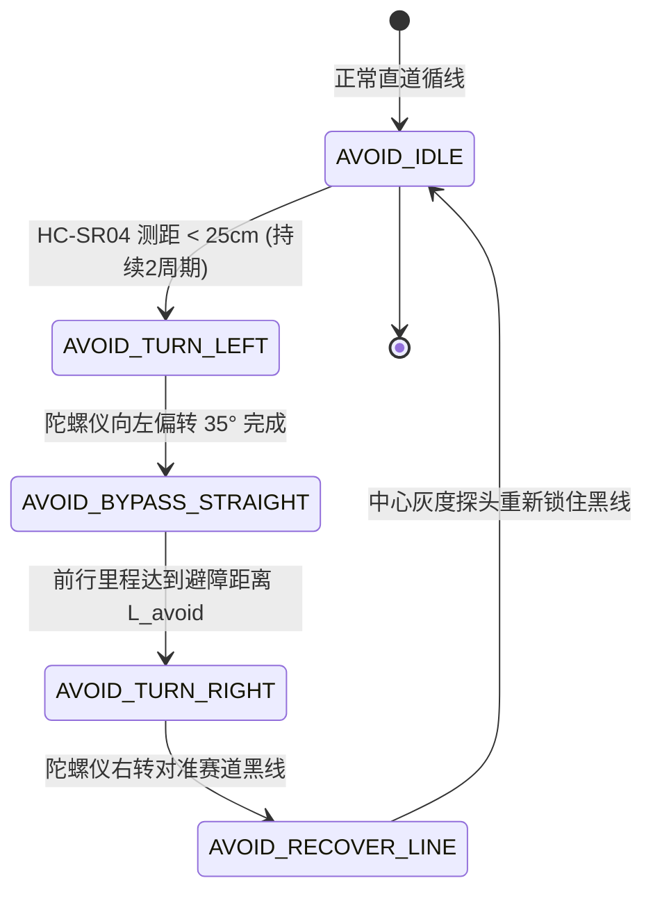

# 04 - 状态机体系、赛题场景建模与重构优化方案

> **对应赛题依据**：[题目.md](file:///c:/Users/34118/Desktop/WorkSpace/G3507-Car/题目.md)（全程匀速循线避障、楼梯多圈闭环、正弦摆动走直线、信标瞄准）  
> **关联源码**：[init/grayscale_sensor.c](file:///c:/Users/34118/Desktop/WorkSpace/G3507-Car/init/grayscale_sensor.c), [init/key.c](file:///c:/Users/34118/Desktop/WorkSpace/G3507-Car/init/key.c), [init.c](file:///c:/Users/34118/Desktop/WorkSpace/G3507-Car/init.c)

---

## 一、 赛道拓扑模型与赛题任务分析

根据《题目.md》，整个比赛场地为一条闭合环形赛道，赛道宽度为 1.8cm 黑色胶带，空间拓扑布局如下：

```text
                  【上方长直道 (Top Straight)】
       ┌───────────────────────[障碍物/正弦段]──────────────────────┐
       │                                                            │
       │                                                            │
 【左侧楼梯段】                                                  【右侧信标区】
┌──[分岔口A]                                                        │
│      │                                                            │
│   (波浪环形)                                                  (O) 信标塔
│   (跑满2圈)                                                  (Ø20/35cm)
│      │                                                            │
└──[合流口B]                                                        │
       │                                                            │
       └────────────────────────[停起点]────────────────────────────┘
                  【下方长直道 (Bottom Straight)】
```

### 任务与控制需求映射矩阵：
| 任务模式 | 楼梯岔路决策 (左侧) | 上方直道动作 | 信标瞄准要求 | 终点要求 |
| :--- | :--- | :--- | :--- | :--- |
| **任务 1：匀速循线避障** | **禁入楼梯**，贴主道外圈直行 | 超声波检出障碍物，**平滑绕障**切回黑线 | 云台 Yaw 实时瞄准信标点 | 绕场一周准确减速自动停起点 |
| **任务 2：楼梯闭环循线** | **必入楼梯**，闭环连续**跑满整两圈**后驶出 | 正常平稳直行 | 云台 Yaw 实时瞄准信标点 | 驶出楼梯后沿主道回停起点刹停 |
| **任务 3：正弦震荡走直线** | **禁入楼梯**，贴主道外圈直行 | 无障碍物，**主动叠加正弦摆动轨迹**通过 | 云台 Yaw 实时瞄准信标点 | 出直道恢复常规循线，回起点刹停 |
| **任务 4：全局信标瞄准** | 贯穿任务 1~3 全程 | 贯穿任务 1~3 全程 | 无论车体直行/转弯/摆动，指针实时锁定信标 | 全程跟踪 |

---

## 二、 现有状态机代码缺陷剖析 (Why Refactor?)

原有 [grayscale_sensor.c](file:///c:/Users/34118/Desktop/WorkSpace/G3507-Car/init/grayscale_sensor.c) 中的状态机实现存在严重架构缺陷，仅为**单层离散枚举的单纯罗列**：

1. **盲人摸象（缺乏空间位姿感知）**：
   - 原状态机仅依靠 8 路灰度的瞬时电平跳转（如 `center_bianhua`），赛道反光、胶带接缝或微小抖动都会导致误入 `state_teshu_lockleft1`；
   - 缺少**编码器累计里程（Odometer）**与**陀螺仪航向角（JY901P Yaw）**的联合门限保护。
2. **楼梯圈数“无法闭环”**：
   - 题目硬性要求“连续跑满整整两圈，防止漏计多跑”。原状态机仅有 `state_stair1`、`state_stair2`，完全没有圈数计数器与防误判逻辑。
3. **任务模式与赛道区间未解耦**：
   - 任务 1（不得入楼梯）和任务 2（必须切入楼梯）被混写在一个全局状态流中，导致逻辑互斥。
4. **恒速指标被破坏**：
   - 题目硬性要求两轮平均速度 $\frac{V_L + V_R}{2} \equiv V_{\text{target}}$ 恒定。原状态机在转弯时直接写入硬编码常数 `set_target(base_pwm, 5)` 或 `-5`，导致转弯时平均线速度剧烈畸变。

---

## 三、 正确的三层分层状态机 (HSM) 结构与跳转拓扑

为了彻底解决上述缺陷，系统重构为 **三层分层有限状态机 (Hierarchical Finite State Machine)**：



---

## 四、 核心场景的依赖跳转与防误判设计

### 1. 楼梯岔路口决策（进 vs 不进 vs 出）

- **空间门限保护**：小车从停起点出发后，设定编码器里程门限 $D_{\text{start\_to\_branch}}$。在未行驶至岔路前，无论传感器怎样误闪，均**屏蔽**任何分支识别状态。
- **特征识别与动作解耦**：
  - **任务 1 / 任务 3 (外圈直行)**：
    当检测到左侧探头有黑线延伸（`pattern_leftbranch`）时，导航状态机进入 `NAV_BRANCH_IGNORE`，此时强制冻结转向 PID 的左修正，仅允许右轮适度修正，**锁定贴主干道右沿直行通过**。
  - **任务 2 (切入楼梯)**：
    当检测到 `pattern_leftbranch`，立即进入 `NAV_STAIR_ENTER`，向左打大转向角切入楼梯分支；当灰度中心探头重新对准楼梯黑线时，切入 `NAV_STAIR_LOOP`。



---

### 2. 楼梯区域跑满两圈的高可靠闭环计数方案 (Robust 2-Lap Loop Counter)

题目严苛要求：**跑满整整两圈，不得多跑也不得漏计**。

单纯靠传感器扫线极其容易因楼梯接缝造成重复计数或漏计。优化方案采用 **“陀螺仪累计转角 + 里程窗口 + 黑线特征点” 三重融合仲裁机制**：

```mermaid
flowchart LR
    IMU[JY901P 累计偏航角 ΔYaw] --> FUSION[圈数裁决仲裁器]
    ODO[左右轮平均里程 Odo] --> FUSION
    GRAY[楼梯特征分岔标定点] --> FUSION

    FUSION -->|ΔYaw ≈ 360° 且 里程在 [L-Δ, L+Δ]| LAP1[Lap_Count = 1]
    LAP1 -->|ΔYaw ≈ 720° 且 里程在 [2L-Δ, 2L+Δ]| LAP2[Lap_Count = 2 完成两圈!]
    LAP2 --> EXIT_STAIR[开启出路口识别, 切回主干道]
```

- **第一重（航向积分）**：小车在环形楼梯内每跑一整圈，JY901P 的连续偏航角累计 $\Delta \theta$ 必经历一次完整的 $\approx 360^\circ$ 旋转；跑满两圈则累计达 $\approx 720^\circ$。
- **第二重（里程锁死）**：测量楼梯一圈单程物理周长 $S_{\text{lap}}$。单圈计数触发必须满足实际里程 $S \in [0.85 \times S_{\text{lap}}, 1.15 \times S_{\text{lap}}]$，严防短时间内因抖动误触发第 2 圈。
- **第三重（退出出路口动作）**：当 `Lap_Count == 2` 成立后，状态机才激活 `ENABLE_STAIR_EXIT` 标志。此时当传感器检测到右侧分岔（合流口）时，执行右打角顺滑切回主干道。

---

### 3. 上方直道避障动作状态机 (任务 1)

超声波（HC-SR04）以 100ms 周期检测前方距离：



- **恒速保障机制**：避障过程中的左打角、直线平移与右切入，左右轮目标均由统一的线速度 $V_0$ 乘以转向比率解算，满足 $\frac{V_L + V_R}{2} \equiv V_0$，严防避障过程中速度下坠扣分。

---

### 4. 上方直道正弦摆动发生器 (任务 3)

小车在进入上方长直道后，底盘电机叠加正弦差速调制波：

$$\Delta V(t) = A \cdot \sin(2\pi f \cdot t)$$
$$\begin{cases}
V_{\text{Left}}(t) = V_{\text{target}} + \Delta V(t) \\
V_{\text{Right}}(t) = V_{\text{target}} - \Delta V(t)
\end{cases}$$

- **平均速度恒定证明**：
  $$\frac{V_{\text{Left}} + V_{\text{Right}}}{2} = \frac{(V_{\text{target}} + \Delta V) + (V_{\text{target}} - \Delta V)}{2} = V_{\text{target}} \quad (\text{绝对恒定})$$
- **防脱轨与状态平滑切出**：
  - 摆幅 $A$ 与频率 $f$ 限制在循迹传感器边缘（最外侧探头刚好触碰黑色边线时限幅）；
  - 当累计里程表明已通过长直道时，正弦发生器在 $\sin=0$ 的过零点平滑退出，无缝接入直角弯前常规巡线。

---

### 5. 绕场一周自动停起点减速逻辑

- **全程总里程监测**：赛道总周长约 $L_{\text{total}}$。小车从起点出发累计总里程达到 $0.9 \times L_{\text{total}}$ 后，进入“进站准备态”；
- **终点黑线检测**：灰度传感器检测到全黑线标志（`pattern_allblack`）；
- **S型平滑减速曲线**：目标速度从 $V_{\text{target}}$ 匀减速至 0，并在平稳停靠在停起点后切入刹车保持态（`allstop()`），避免急刹冲出车位。

---

## 五、 代码具体优化实施规范 (Implementation Blueprint)

### 1. 导航与状态机核心结构体重构建议

后续代码重构时，建议在 `grayscale_sensor.h` 中用以下结构体替换混乱的全局散装变量：

```c
/* 顶层任务定义 */
typedef enum {
    TASK_IDLE = 0,
    TASK_1_SPEED_OBSTACLE,   // 任务1：全程匀速循线避障
    TASK_2_STAIR_LOOP,       // 任务2：楼梯双圈闭环
    TASK_3_SINE_SWAY,        // 任务3：正弦走直线
} CarTaskMode;

/* 赛道空间导航分区 */
typedef enum {
    SEG_START_ACCEL = 0,     // 起点出发与加速段
    SEG_BEFORE_BRANCH,       // 楼梯前主道直行段 (屏蔽分支误判)
    SEG_BRANCH_DECISION,     // 楼梯分岔决策口 (进 or 绕)
    SEG_STAIR_CIRCULATION,   // 楼梯环形多圈区
    SEG_TOP_STRAIGHT,        // 上方长直道 (避障 or 正弦)
    SEG_APPROACH_FINAL,      // 进站预备段
    SEG_FINISH_BRAKE         // 起点平稳刹停
} TrackSegment;

/* 统一导航控制上下文 */
typedef struct {
    CarTaskMode task_mode;         // 当前运行的大赛模式
    TrackSegment current_segment;  // 当前所处的赛道区间
    
    uint32_t segment_tick;         // 当前区间驻留时间 (ms)
    float segment_start_odometer;  // 进入当前区间时的基准里程 (cm)
    
    /* 楼梯任务专属闭环变量 */
    uint8_t stair_lap_count;       // 楼梯已跑完圈数 (目标2圈)
    float stair_accum_yaw;         // 楼梯内连续累计偏航角
    
    /* 避障专属状态机 */
    uint8_t obstacle_stage;        // 0:未检测 1:左转出 2:平行走 3:右转回
    
    /* 正弦摆动专属状态 */
    float sine_phase;              // 当前正弦相位
} NavigationContext;
```

### 2. 状态机执行流标准循环实现

在主定时器或任务调度中，统一通过结构清晰的路由函数驱动：

```c
void Navigation_RunFSM(NavigationContext *ctx, SensorSnapshot_t *sensors)
{
    float current_odo = Odometer_GetDistance();
    float seg_distance = current_odo - ctx->segment_start_odometer;

    switch (ctx->current_segment)
    {
        case SEG_BEFORE_BRANCH:
            // 采用里程门限防护：未到达物理岔路前，绝不误触进楼梯分支
            if (seg_distance >= DIST_TO_BRANCH_GATE) {
                ctx->current_segment = SEG_BRANCH_DECISION;
                ctx->segment_start_odometer = current_odo;
            } else {
                Track_ExecuteNormalPID(TARGET_CRUISE_SPEED);
            }
            break;

        case SEG_BRANCH_DECISION:
            if (ctx->task_mode == TASK_2_STAIR_LOOP) {
                // 任务2：识别到左分支切入楼梯
                if (sensors->pattern == pattern_leftbranch) {
                    ctx->current_segment = SEG_STAIR_CIRCULATION;
                    ctx->stair_lap_count = 0;
                    ctx->stair_accum_yaw = 0.0f;
                }
            } else {
                // 任务1/3：锁定贴右直行通过，禁入楼梯
                Track_ExecuteClampRightPID(TARGET_CRUISE_SPEED);
                if (seg_distance >= DIST_CROSS_BRANCH) {
                    ctx->current_segment = SEG_TOP_STRAIGHT;
                }
            }
            break;

        case SEG_STAIR_CIRCULATION:
            // 楼梯双圈闭环执行与计数
            Stair_ExecuteDualLapLoop(ctx, sensors);
            break;

        case SEG_TOP_STRAIGHT:
            if (ctx->task_mode == TASK_1_SPEED_OBSTACLE) {
                Obstacle_ExecuteAvoidance(ctx, sensors);
            } else if (ctx->task_mode == TASK_3_SINE_SWAY) {
                Sine_ExecuteStraightSway(ctx, sensors);
            } else {
                Track_ExecuteNormalPID(TARGET_CRUISE_SPEED);
            }
            break;

        // ... 其余区间依此类推
    }
}
```

---

## 六、 总结与后续 AI 维护提示

1. **绝对禁止退化**：后续修改代码时，严禁再次退回只依靠 8 路灰度引脚电平随意跳转的散装状态机。
2. **多源数据融合**：所有关键场景跳转必须满足：
   $$\text{状态迁移条件} = \text{赛道灰度特征} \ \mathbf{AND} \ \text{编码器里程窗口} \ \mathbf{AND} \ \text{陀螺仪航向门限}$$
3. **恒速指标自检**：调试任何转弯、避障和正弦摆动算法时，务必通过调试串口打印 $(V_L + V_R)/2$，确保全程线速度方差最小化。
