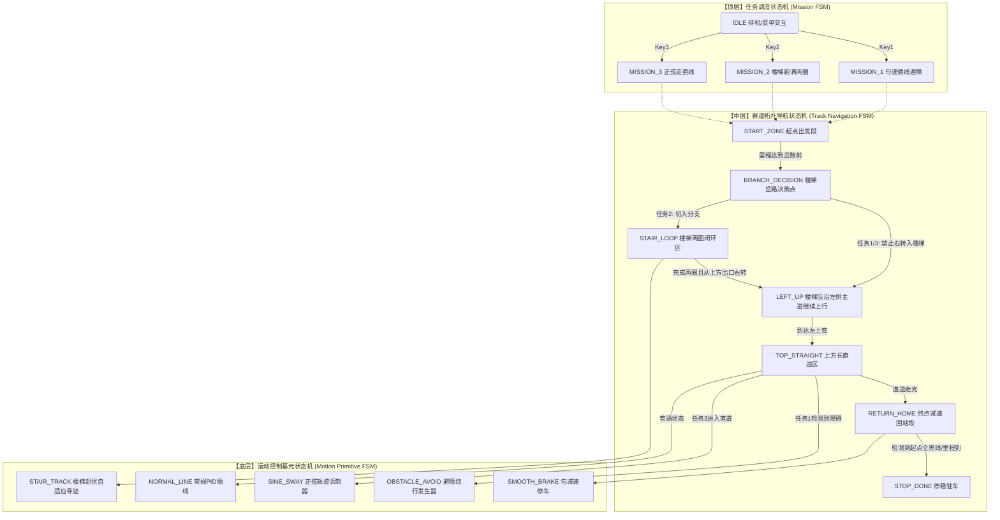
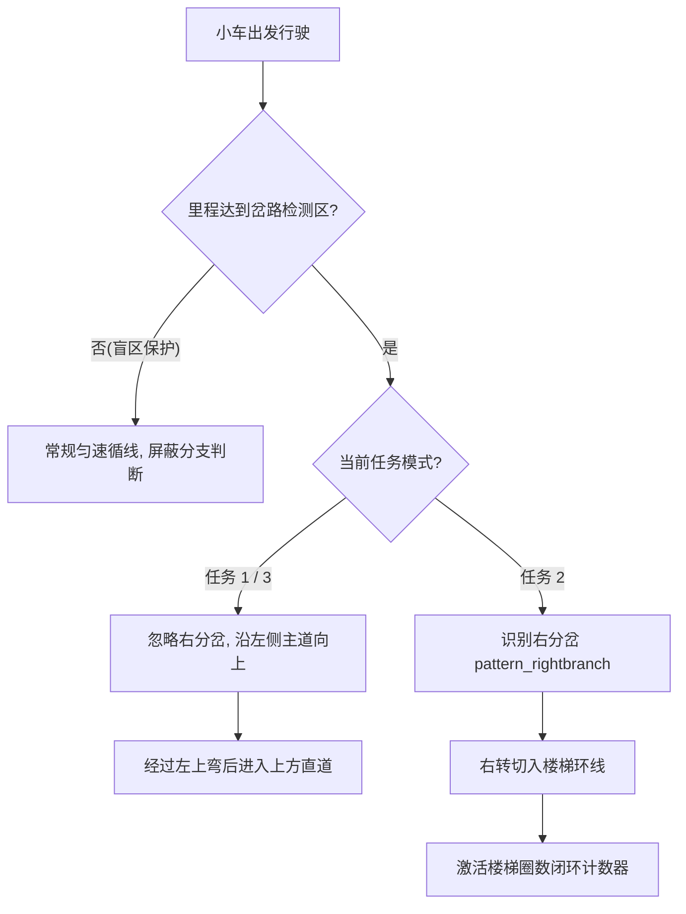
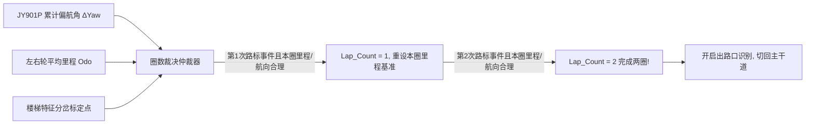
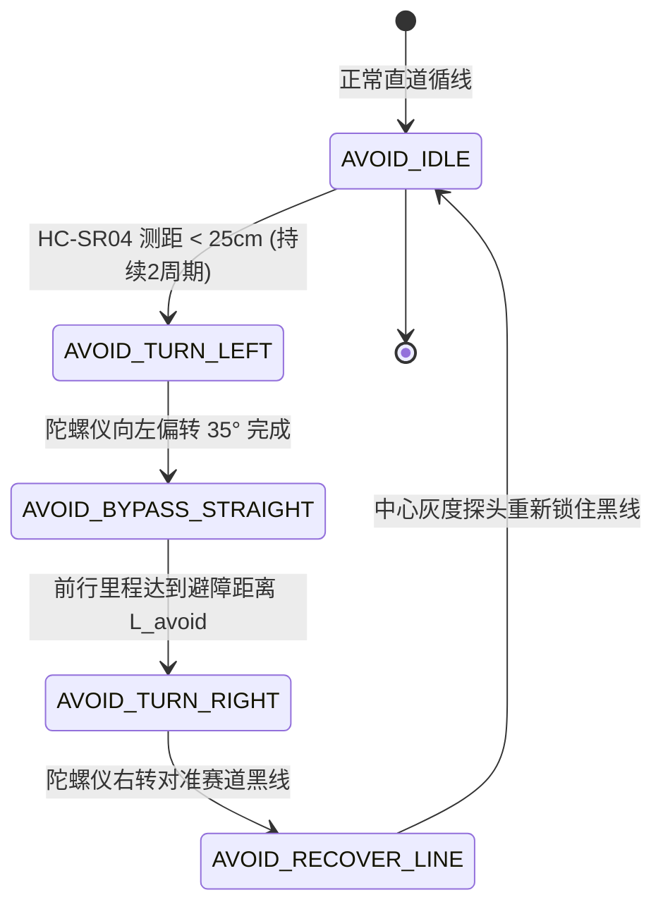

# 04 - 状态机体系、赛题场景建模与重构优化方案

> **对应赛题依据**：[题目.md](file:///c:/Users/34118/Desktop/WorkSpace/G3507-Car/题目.md)（全程匀速循线避障、楼梯多圈闭环、正弦摆动走直线、信标瞄准）  
> **关联源码**：[init/grayscale_sensor.c](file:///C:\Users\34031\Desktop\mpsm0\outputs\MSPM0G3507-second_process\init\grayscale_sensor.c), [init/key.c](file:///C:\Users\34031\Desktop\mpsm0\outputs\MSPM0G3507-second_process\init\key.c), [init.c](file:///C:\Users\34031\Desktop\mpsm0\outputs\MSPM0G3507-second_process\init.c)

> **伪代码发车方向（顺时针）**：下方右侧停起点朝左发车 → 下方直道向左 → 左侧竖道向上（楼梯入口在车身右侧）→ 左上弯 → 上方直道向右 → 右侧竖道向下 → 下方直道向左回停起点。此约定对应根目录 `应用层状态机切换逻辑_伪代码.c`，尚未接入实际 `init.c` 主循环。

---

## 当前按键 1 调试模式与普通循迹逻辑

- 上电和待机时双轮目标为 0；按键每 5 ms 扫描一次，消抖阈值为 6 次（30 ms），按键 1 确认按下后模式变为 `key1_putong`。
- 按键 4 经过 30 ms 消抖确认后，在按键定时中断里立即把双轮目标设为 0，并递增 `key4_confirm_count`；主循环随后同步待机模式。若按键在主循环读取模式之后触发，主循环在一次循迹计算后再次检查模式并将目标清零。
- `TIMG8` 每 10 ms 采样灰度，按从左到右的 GRAY1～GRAY8 顺序将 8 路读数（黑线为 1）与本次识别的 `pattern`、`error` 一起发布；主循环收到新样本后运行 `trackcontroll()`。按键 1 调用 `track_run_normal()`，使用灰度偏差进行转向纠偏。
- `track_run_normal()` 在丢线时把双轮目标设为 0；连续 3 次检测到右分岔时进入直行锁定，连续 3 次回到普通线段后退出锁定。10 ms 采样下 3 次确认约为 30 ms，需实车整定。切换模式会清除路口阶段和确认计数。
- 主循环保持 10 ms 一次的灰度采样和控制，每 5 个样本（约 50 ms）打印一次 8 路读数、`pattern`、状态、按键模式和双轮 PWM，降低 115200 bps 串口拥塞。上电打印 `event=boot,reset=...,reason=...`；K4 消抖确认后打印 `event=key4_confirmed,count=...`。`key4_idle` 时的 `state=inactive` 只是待机模式的显示，不表示按键 1 的循迹子状态自行跳转。超声波避障、终点自动停和特殊任务仍属于下文的设计目标；实际速度、灰度极性及转向增益需实车确认。

---

## 一、 赛道拓扑模型与赛题任务分析

根据《题目.md》，整个比赛场地为一条闭合环形赛道，赛道宽度为 1.8cm 黑色胶带，空间拓扑布局如下：

```text
                  【上方长直道 (Top Straight)】
       ┌───────────────────────[障碍物/正弦段]──────────────────────┐
       │                                                            │
       │                                                            │
 【左侧楼梯段】                                                  【右侧信标区】
┌──[分岔口A]                                                        │
│      │                                                            │
│   (波浪环形)                                                  (O) 信标塔
│   (跑满2圈)                                                  (Ø20/35cm)
│      │                                                            │
└──[合流口B]                                                        │
       │                                                            │
       └─────────[障碍物]───────────────[停起点]────────────────────────────┘
                  【下方长直道 (Bottom Straight)】
```

### 任务与控制需求映射矩阵：
| 任务模式 | 楼梯岔路决策 (左侧) | 上方直道动作 | 信标瞄准要求 | 终点要求 |
| :--- | :--- | :--- | :--- | :--- |
| **任务 1：匀速循线避障** | **禁入楼梯**，贴主道外圈直行 | 超声波检出障碍物，**平滑绕障**切回黑线 | 云台 Yaw 实时瞄准信标点 | 绕场一周准确减速自动停起点 |
| **任务 2：楼梯闭环循线** | **必入楼梯**，闭环连续**跑满整两圈**后驶出 | 正常平稳直行 | 云台 Yaw 实时瞄准信标点 | 驶出楼梯后沿主道回停起点刹停 |
| **任务 3：正弦震荡走直线** | **禁入楼梯**，贴主道外圈直行 | 无障碍物，**主动叠加正弦摆动轨迹**通过 | 云台 Yaw 实时瞄准信标点 | 出直道恢复常规循线，回起点刹停 |
| **任务 4：全局信标瞄准** | 贯穿任务 1~3 全程 | 贯穿任务 1~3 全程 | 无论车体直行/转弯/摆动，指针实时锁定信标 | 全程跟踪 |

---

## 二、 现有状态机代码缺陷剖析 (Why Refactor?)

原有 [grayscale_sensor.c](file:///C:\Users\34031\Desktop\mpsm0\outputs\MSPM0G3507-second_process\init\grayscale_sensor.c) 中的状态机实现存在严重架构缺陷，仅为**单层离散枚举的单纯罗列**：

1. **盲人摸象（缺乏空间位姿感知）**：
   - 原状态机仅依靠 8 路灰度的瞬时电平跳转（如 `center_bianhua`），赛道反光、胶带接缝或微小抖动都会导致误入 `state_teshu_lockleft1`；
   - 缺少**编码器累计里程（Odometer）**与**陀螺仪航向角（JY901P Yaw）**的联合门限保护。
2. **楼梯圈数“无法闭环”**：
   - 题目硬性要求“连续跑满整整两圈，防止漏计多跑”。原状态机仅有 `state_stair1`、`state_stair2`，完全没有圈数计数器与防误判逻辑。
3. **任务模式与赛道区间未解耦**：
   - 任务 1（不得入楼梯）和任务 2（必须切入楼梯）被混写在一个全局状态流中，导致逻辑互斥。
4. **起步速度规则**：
   - 按当前任务要求，发车后的首个控制周期直接下发 35% PWM 目标，不设置平滑加速阶段。

---

## 三、 正确的三层分层状态机 (HSM) 结构与跳转拓扑

为了彻底解决上述缺陷，系统重构为 **三层分层有限状态机 (Hierarchical Finite State Machine)**：



---

## 四、 核心场景的依赖跳转与防误判设计

### 0. 发车速度与状态转移要求

- **取消强制恒速条件**：状态机不再要求转弯、楼梯、避障和正弦段的双轮平均速度始终等于某个固定值。各路段可根据循迹稳定性与障碍距离调整目标速度；调试时仍需观察实际速度，避免不必要的突变。
- **直接配置 35% PWM**：从停起点启动后，第一个控制周期直接将基准目标设为 35% PWM。35% 是控制指令，实际轮速仍需通过编码器反馈查看。
- **起步态退出条件**：起点累计里程达到 30 cm 后转入楼梯前盲区，不再附加“已平滑加速到目标速度”的条件。

### 1. 楼梯岔路口决策（进 vs 不进 vs 出）

- **空间门限保护**：小车从下方右侧停起点朝左出发，沿下方直道向左、左侧竖道向上。编码器里程只用于开启岔口识别窗口，例如在标定值附近的 `[D_min, D_max]` 内寻找右侧分支；不能要求里程等于单个数值。进入下一路段时重设该路段的里程基准，避免前段误差逐段传递。
- **特征识别与动作解耦**：
  - **任务 1 / 任务 3 (外圈直行)**：
    顺时针上行时楼梯入口在车身右侧。检测到右侧分支（`pattern_rightbranch`）时，仅在岔口窗口内抑制朝右侧分支的转向修正，沿左侧主道继续向上；通过岔口后恢复双向纠偏。
  - **任务 2 (切入楼梯)**：
    当检测到 `pattern_rightbranch`，进入 `NAV_STAIR_ENTER`，右转切入楼梯分支；灰度中心探头重新对准楼梯黑线后进入 `NAV_STAIR_LOOP`。在上方合流口完成两圈后，从内侧向西行驶并右转回主道，继续向上到左上弯。



---

### 2. 楼梯区域跑满两圈的高可靠闭环计数方案 (Robust 2-Lap Loop Counter)

题目严苛要求：**跑满整整两圈，不得多跑也不得漏计**。

单纯靠传感器扫线极其容易因楼梯接缝造成重复计数或漏计。采用 **“路标触发 + 本圈相对里程窗口 + 连续航向角合理性检查”**：路标是计圈事件，里程与 IMU 限制事件发生的合理区域；不把三个测量值和地图上的单个精确数字做硬相等比较。



- **航向检查**：将 JY901P 的跨 ±180° 变化展开为连续角度。每圈约 360° 是参考值，在实测允许范围内用于排除明显错误；IMU 数据无效时不能将旧角度当作新角度。
- **相对里程窗口**：每次确认圈数后重设本圈里程基准。先实测一圈周长 `S_lap`，再按多次跑车误差标定 `[S_min, S_max]`；文中的 115 cm 和 ±20 cm 只是示例，不能直接当作实车精确值。
- **路标去重与超窗处理**：同一次路标只计一次，必须离开路标并再次进入才允许下一圈计数。若超过扩展搜索窗口仍没有可信路标，转入待确认/安全停机并记录原因；不可无限停留在原状态，也不可直接按里程猜测已完成一圈。
- **第三重（退出出路口动作）**：当 `Lap_Count == 2` 成立后，状态机才激活 `ENABLE_STAIR_EXIT` 标志。沿内侧支线向西到上方合流口时，检测右侧主道并右转切回；楼梯局部绕圈方向由实际走线决定，不等同于外圈顺时针方向。

---

### 3. 上方直道避障动作状态机 (任务 1)

以下为尚未实现的避障设计方案。当前 SysConfig 已删除 HC-SR04 的引脚和 `TIMG6` 配置，固件不会以 100 ms 周期检测前方距离：




---

### 4. 上方直道正弦摆动发生器 (任务 3)

小车在进入上方长直道后，底盘电机可在当前目标速度上叠加正弦差速调制波：

`ΔV(t) = A × sin(2πft)`

- `V_Left,cmd(t) = V_base(t) + ΔV(t)`
- `V_Right,cmd(t) = V_base(t) - ΔV(t)`

- `V_base(t)` 可按循迹稳定性调整；左右轮限幅与闭环误差会使实际平均轮速变化，不将指令的对称形式当作实车恒速保证。
- **防脱轨与状态平滑切出**：
  - 摆幅 `A` 与频率 `f` 限制在循迹传感器边缘（最外侧探头刚好触碰黑色边线时限幅）；
  - 当累计里程表明已通过长直道时，正弦发生器在 `sin(2πft) = 0` 的过零点平滑退出，无缝接入直角弯前常规巡线。

---

### 5. 绕场一周自动停起点减速逻辑

- **全程总里程监测**：赛道总周长约 `L_total`。小车从起点出发累计总里程达到 `0.9 × L_total` 后，进入“进站准备态”；
- **终点黑线检测**：灰度传感器检测到全黑线标志（`pattern_allblack`）；
- **刹车**：第二次识别到全黑时，直接切换到电机停机即可，不需要完成匀减速曲线刹停

---

## 五、 代码具体优化实施规范 (Implementation Blueprint)

### 1. 导航与状态机核心结构体重构建议

后续代码重构时，建议在 `grayscale_sensor.h` 中用以下结构体替换混乱的全局散装变量：

```c
/* 顶层任务定义 */
typedef enum {
    TASK_IDLE = 0,
    TASK_1_SPEED_OBSTACLE,   // 任务1：全程匀速循线避障
    TASK_2_STAIR_LOOP,       // 任务2：楼梯双圈闭环
    TASK_3_SINE_SWAY,        // 任务3：正弦走直线
} CarTaskMode;

/* 赛道空间导航分区 */
typedef enum {
    SEG_START_DIRECT = 0,    // 起点直接下发35% PWM目标
    SEG_BEFORE_BRANCH,       // 楼梯前主道直行段 (屏蔽分支误判)
    SEG_BRANCH_DECISION,     // 楼梯分岔决策口 (进 or 绕)
    SEG_STAIR_CIRCULATION,   // 楼梯环形多圈区
    SEG_LEFT_UP,             // 通过楼梯区域后继续上行，到左上弯才切换状态
    SEG_TOP_STRAIGHT,        // 上方长直道 (避障 or 正弦)
    SEG_APPROACH_FINAL,      // 进站预备段
    SEG_FINISH_BRAKE         // 起点平稳刹停
} TrackSegment;

/* 统一导航控制上下文 */
typedef struct {
    CarTaskMode task_mode;         // 当前运行的大赛模式
    TrackSegment current_segment;  // 当前所处的赛道区间
    
    uint32_t segment_tick;         // 当前区间驻留时间 (ms)
    float segment_start_odometer;  // 进入当前区间时的基准里程 (cm)
    
    /* 楼梯任务专属闭环变量 */
    uint8_t stair_lap_count;       // 楼梯已跑完圈数 (目标2圈)
    float stair_accum_yaw;         // 楼梯内连续累计偏航角
    
    /* 避障专属状态机 */
    uint8_t obstacle_stage;        // 0:未检测 1:左转出 2:平行走 3:右转回
    
    /* 正弦摆动专属状态 */
    float sine_phase;              // 当前正弦相位
} NavigationContext;
```

### 2. 状态机执行流标准循环实现

在主定时器或任务调度中，统一通过结构清晰的路由函数驱动：

```c
void Navigation_RunFSM(NavigationContext *ctx, SensorSnapshot_t *sensors)
{
    float current_odo = Odometer_GetDistance();
    float seg_distance = current_odo - ctx->segment_start_odometer;

    switch (ctx->current_segment)
    {
        case SEG_BEFORE_BRANCH:
            // 采用里程门限防护：未到达物理岔路前，绝不误触进楼梯分支
            if (seg_distance >= DIST_TO_BRANCH_GATE) {
                ctx->current_segment = SEG_BRANCH_DECISION;
                ctx->segment_start_odometer = current_odo;
            } else {
                Track_ExecuteNormalPID(TARGET_CRUISE_SPEED);
            }
            break;

        case SEG_BRANCH_DECISION:
            if (ctx->task_mode == TASK_2_STAIR_LOOP) {
                // 顺时针上行时右侧为楼梯入口，任务2右转切入
                if (sensors->pattern == pattern_rightbranch) {
                    ctx->current_segment = SEG_STAIR_CIRCULATION;
                    ctx->stair_lap_count = 0;
                    ctx->stair_accum_yaw = 0.0f;
                }
            } else {
                // 任务1/3：岔口窗口内抑制右转，沿左侧主道直行
                Track_ExecuteClampLeftPID(TARGET_CRUISE_SPEED);
                if (seg_distance >= DIST_CROSS_BRANCH) {
                    ctx->current_segment = SEG_LEFT_UP;
                    ctx->segment_start_odometer = current_odo;
                }
            }
            break;

        case SEG_STAIR_CIRCULATION:
            // 楼梯双圈闭环执行与计数
            Stair_ExecuteDualLapLoop(ctx, sensors);
            // 两圈后从上方合流口右转回左侧主道，再切换到 SEG_LEFT_UP
            break;

        case SEG_LEFT_UP:
            Track_ExecuteNormalPID(TARGET_CRUISE_SPEED);
            // 到达左上弯后才允许启动上方直道的避障或正弦动作
            if (Track_ReachedTopStraight(ctx, current_odo)) {
                ctx->current_segment = SEG_TOP_STRAIGHT;
                ctx->segment_start_odometer = current_odo;
            }
            break;

        case SEG_TOP_STRAIGHT:
            if (ctx->task_mode == TASK_1_SPEED_OBSTACLE) {
                Obstacle_ExecuteAvoidance(ctx, sensors);
            } else if (ctx->task_mode == TASK_3_SINE_SWAY) {
                Sine_ExecuteStraightSway(ctx, sensors);
            } else {
                Track_ExecuteNormalPID(TARGET_CRUISE_SPEED);
            }
            break;

        // ... 其余区间依此类推
    }
}
```

---

## 六、 总结与后续 AI 维护提示

1. **绝对禁止退化**：后续修改代码时，严禁再次退回只依靠 8 路灰度引脚电平随意跳转的散装状态机。
2. **多源数据融合**：灰度路标负责事件确认；当前路段的相对里程提供搜索窗口；IMU 航向提供合理性检查。每个状态都要定义正常窗口、扩展窗口和超窗后的待确认/安全停机路径，不使用全程累计里程与航向的单点硬匹配。
3. **速度指令自检**：通过调试串口观察发车时的 35% PWM 目标、左右轮实际编码器速度和路段状态，并检查转弯及避障时有无不必要的速度突变。
4. **多源数据仅提供合理范围**
